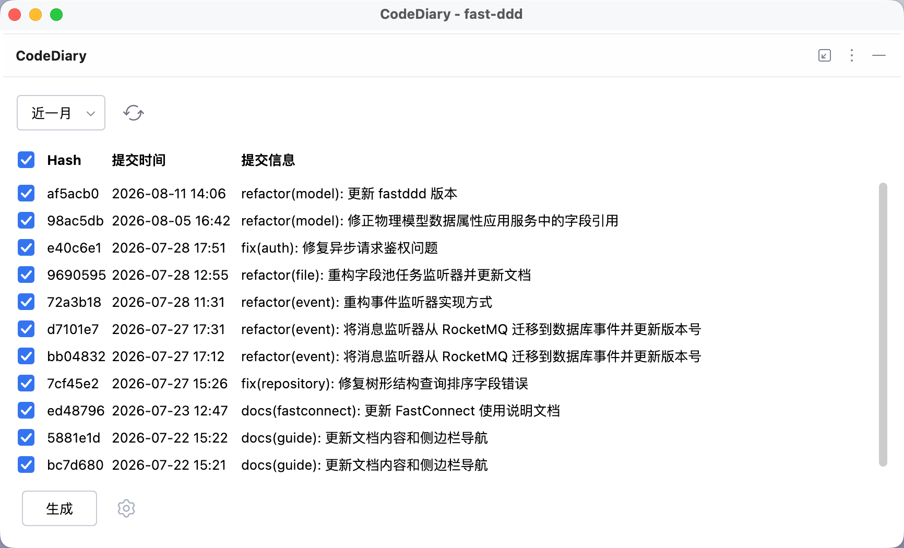
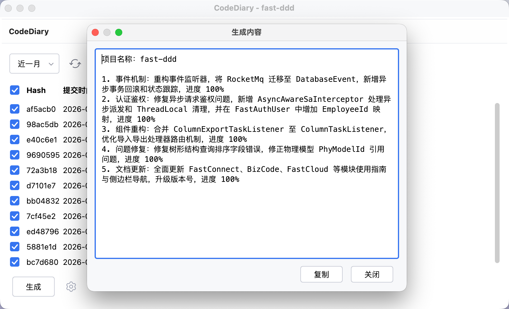
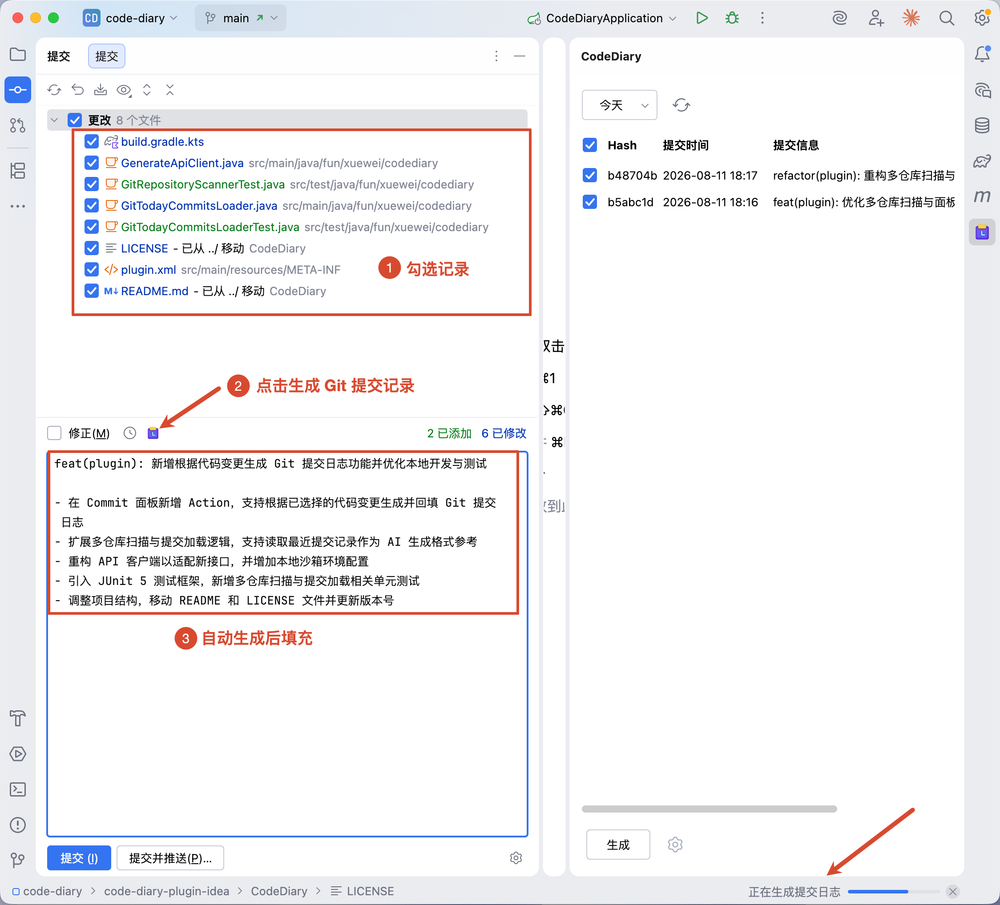
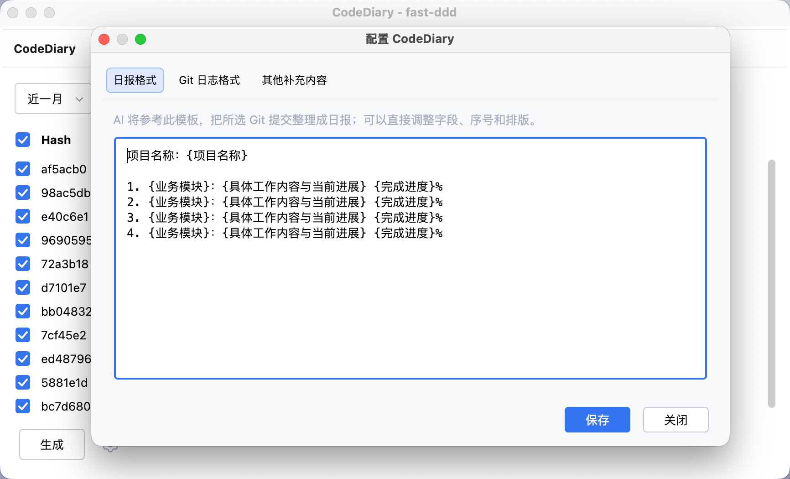

<p align="center">
  
</p>

<h1 align="center">CodeDiary</h1>

<p align="center">
  让代码说话，让 AI 翻译<br />
  基于 Git 提交记录生成工作日报，也能根据代码变更生成 Git 提交日志
</p>

<p align="center">
  <a href="https://code-diary.xuewei.fun">官方网站</a> ·
  <a href="https://plugins.jetbrains.com/plugin/29992-codediary">安装插件</a> ·
  <a href="https://github.com/isxuewei/CodeDiary/issues">问题反馈</a>
</p>

---

## CodeDiary 能做什么？

CodeDiary 是一款面向 IntelliJ IDEA 的 AI 编程效率插件，将 Git 记录与日常工作汇报连接起来：

- 自动扫描当前项目及子目录中的多个 Git 仓库
- 按日期范围查询并筛选需要汇报的提交记录
- 将技术性的提交信息整理成清晰、专业的工作日报
- 根据 Commit 面板中已勾选的代码变更生成 Git 提交日志并自动回填
- 自定义日报格式、Git 日志格式和其他生成要求

<p align="center">
  
</p>

<p align="center">
  
</p>

---

## 推荐使用方式

1. 在 [JetBrains Marketplace](https://plugins.jetbrains.com/plugin/29992-codediary) 安装 **CodeDiary**
2. 使用 IntelliJ IDEA 打开一个包含 Git 仓库的项目
3. 从 IDE 右侧工具窗口打开 **CodeDiary**
4. 选择日期范围，勾选需要纳入汇报的提交记录
5. 点击「生成」，确认内容后复制到日报、周报或项目汇报中

生成 Git 提交日志时，在 Commit 面板勾选本次要提交的文件，点击 CodeDiary 图标，插件会分析所选变更并将生成结果回填到提交消息框。

<p align="center">
  
</p>

---

## 主要功能

| 能力 | 说明 |
|------|------|
| 多仓库扫描 | 自动发现项目及子目录中的 Git 仓库，集中加载提交记录 |
| 日期范围筛选 | 支持快捷时间范围和自定义起止日期 |
| 提交记录选择 | 展示 Hash、提交时间和提交信息，可按需勾选或全选 |
| AI 日报生成 | 根据项目名称和所选 Git 提交生成结构化工作日报 |
| Git 日志生成 | 分析已选择文件的 unified diff，结合近期提交风格生成 commit message |
| 自定义模板 | 可分别设置日报格式、Git 日志格式和个性化补充要求 |
| 一键复制与回填 | 日报结果可直接复制，Git 日志可自动写入 Commit 面板 |

<p align="center">
  
</p>

---

## 安装方式

### 从插件市场安装（推荐）

1. 打开 IntelliJ IDEA
2. 进入 `Settings/Preferences → Plugins → Marketplace`
3. 搜索 `CodeDiary`，作者选择「薛伟同学」
4. 点击 `Install`，按提示重启 IDE

### 手动安装

1. 从 [JetBrains Marketplace](https://plugins.jetbrains.com/plugin/29992-codediary) 下载插件包
2. 进入 `Settings/Preferences → Plugins → ⚙️ → Install Plugin from Disk...`
3. 选择下载的 ZIP 文件并完成安装

当前源码的兼容范围为 IntelliJ IDEA 2021.3.3 至 2025.3.x。

---

## 项目组成

本仓库包含 CodeDiary 的 IntelliJ IDEA 插件和配套生成服务：

| 目录 | 说明 | 技术栈 |
|------|------|--------|
| [code-diary-plugin-idea](code-diary-plugin-idea/) | 扫描 Git 仓库、展示提交记录、收集代码变更并呈现生成结果 | Java 11、IntelliJ Platform SDK、JGit、Gradle |
| [code-diary-server](code-diary-server/) | 接收插件请求、组织提示词并调用 AI 生成日报或提交日志 | Java 8、Spring Boot 2.7、Maven |
| [images](images/) | README 使用的产品截图与 Logo | — |

---

## 给开发者的简要说明

本地开发需要准备 **Java 8**（服务端）和 **Java 11**（插件）。插件已包含 Gradle Wrapper，服务端使用 Maven 构建。

### 1. 配置并启动服务端

服务端通过 Anthropic Messages 兼容接口调用 AI。启动前请设置以下环境变量：

```bash
export AI_URL='https://你的服务地址/v1/messages'
export AI_KEY='替换为你的 API Key'
export AI_MODEL='替换为模型名称'

cd code-diary-server
mvn spring-boot:run
```

`AI_URL` 需要填写完整的 Messages 接口地址，服务端不会自动追加 `/v1/messages`。本地默认监听 `http://127.0.0.1:8080`。

### 2. 启动插件沙箱

```bash
cd code-diary-plugin-idea
./gradlew runIde
```

`runIde` 会将插件切换到本地开发环境，请求发送到本机的 CodeDiary 服务；安装后的正式插件默认使用线上服务。

### 3. 测试与构建

```bash
# 服务端测试与打包
cd code-diary-server
mvn test
mvn clean package

# 插件测试与打包
cd code-diary-plugin-idea
./gradlew test
./gradlew buildPlugin
```

插件分发包生成在 `code-diary-plugin-idea/build/distributions/`，服务端 JAR 生成在 `code-diary-server/target/`。

---

## 服务端配置

| 环境变量 | 默认值 | 说明 |
|----------|--------|------|
| `AI_URL` | 空 | Anthropic Messages 兼容接口的完整地址 |
| `AI_KEY` | 空 | 服务端调用 AI 所需的 API Key |
| `AI_MODEL` | 空 | 使用的模型名称 |
| `RATE_LIMIT_ENABLED` | `true` | 是否开启接口限流 |
| `RATE_LIMIT_REQUESTS_PER_MINUTE` | `60` | 每个客户端 IP 每分钟允许的请求数 |
| `RATE_LIMIT_TRUST_FORWARDED_HEADERS` | `false` | 是否信任反向代理传入的客户端 IP 请求头 |

只有在服务部署于可信反向代理之后，才应开启 `RATE_LIMIT_TRUST_FORWARDED_HEADERS`。

---

## 隐私与安全说明

- 生成日报时，插件会把所选提交信息、项目名称、格式模板和补充要求发送到 CodeDiary 服务
- 生成 Git 提交日志时，插件会把所选代码变更和近期提交记录发送到 CodeDiary 服务及其配置的 AI 模型
- API Key 只应配置在服务端环境变量或部署平台的 Secret 中，不应写入源码或插件客户端
- 提交代码或公开仓库前，请检查配置文件、日志和 Git 历史中是否包含密钥
- 如果代码变更中包含密码、Token 或其他敏感信息，请不要将其发送给不受信任的服务

---

## 贡献

欢迎提交 Issue 和 Pull Request：

1. Fork 本仓库
2. 创建功能分支：`git checkout -b feature/your-feature`
3. 提交变更：`git commit -m 'feat: 添加新功能'`
4. 推送分支并发起 Pull Request

---

## 许可证

MIT · 作者：[薛伟同学](https://github.com/isxuewei)

